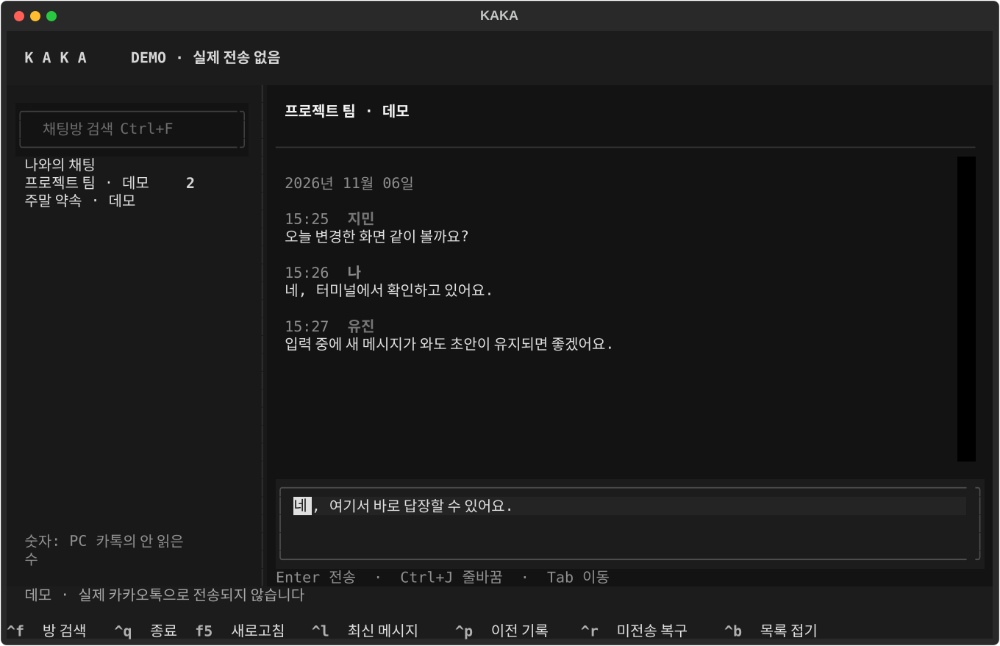

# KAKA

**ORCA 터미널 안에서 직접 읽고 답장하는 Windows용 카카오톡 TUI.**

방 목록과 검색, 발신자·시간·본문, 새 메시지 갱신, Enter 전송을 한 화면에 둡니다.
AI 모델이나 MCP 없이 일반 터미널 프로그램으로 실행합니다. PC 카카오톡의 로그인은 그대로 사용합니다.



> 현재 상태: 첫 구현. 데모·프로토콜·상태 관리·TUI 자동 테스트와 Windows/Linux CI를 제공합니다.
> **실제 Windows 카카오톡 수신/전송과 ORCA의 한글 IME는 아직 실기 검증 전입니다.**
> 검증 범위와 수동 확인 절차는 [VALIDATION.md](docs/VALIDATION.md)에 기록합니다.

## Windows에서 시작

필요한 것: Windows 10/11, **64비트 Python 3.11 이상**, Git, **64비트 PC 카카오톡**.
ORCA의 일반 PowerShell 터미널에서 실행합니다.

```powershell
git clone https://github.com/ssuukko/kaka.git
cd kaka
powershell -NoProfile -ExecutionPolicy Bypass -File .\scripts\setup.ps1
```

설치는 이 폴더의 `.venv`에 앱을, `.engine/nichirin`에 고정 버전 연동 엔진을 내려받습니다.
`-ExecutionPolicy Bypass`는 이 PowerShell 프로세스에만 적용하며 시스템 설정을 바꾸지 않습니다.
`setup.ps1`은 기존 엔진에 수정 사항이 있으면 덮어쓰지 않고 중단합니다.

먼저 실제 대화에 접근하지 않는 데모로 입력과 화면을 확인하세요.

```powershell
powershell -NoProfile -ExecutionPolicy Bypass -File .\start.ps1 -Demo
```

실제 연결은 PC 카카오톡에 로그인하고 사용할 방을 한 번 연 후 최소화한 상태에서 실행합니다.

```powershell
powershell -NoProfile -ExecutionPolicy Bypass -File .\start.ps1 -Doctor
powershell -NoProfile -ExecutionPolicy Bypass -File .\start.ps1
```

특정 방으로 시작할 수도 있습니다. 이름이 중복되면 목록에서 직접 선택합니다.

```powershell
.\.venv\Scripts\python.exe -m kaka --room "나와의 채팅"
```

다음 실행부터는 `start.ps1`만 사용하면 됩니다. 카톡 PC 앱은 계속 실행되어 있어야 합니다.
ORCA 탭은 일반 터미널로 열고, 그 안에서 KAKA를 실행하세요.

## 사용법

왼쪽 방 목록에서 선택하고 Enter를 누르면 오른쪽에 대화가 표시됩니다. 아래 입력란에 직접 작성합니다.

| 키 | 동작 |
| --- | --- |
| Enter | 현재 방으로 텍스트 전송 |
| Ctrl+J | 줄바꿈 (Shift+Enter를 구분하는 터미널에서는 Shift+Enter도 가능) |
| Tab / Shift+Tab | 입력란·목록 등 포커스 이동 |
| Ctrl+F | 채팅방 검색 |
| Ctrl+L | 최신 메시지로 이동 |
| Ctrl+P | 이전 기록 100개 불러오기 |
| Ctrl+R | 실패·미확인 전송 본문을 입력란에 복구 (현재 초안은 덮어쓰지 않음) |
| Ctrl+B | 방 목록 접기/펼치기 |
| F5 | 연결·방 목록·현재 대화 새로고침 |
| Ctrl+Q | 종료 |

여러 줄 붙여넣기는 글자만 넣고 전송하지 않습니다. 방을 바꾸면 초안을 방별로 기억합니다.
초안은 메모리에만 남으며 앱을 종료하면 사라집니다. 과거를 읽는 중에는 새 메시지로 화면을
아래로 당기지 않습니다. 좁은 ORCA 분할창에서는 Ctrl+B로 목록을 접으세요.

### 전송 표시

- **전송 중**: 요청 처리 중. Enter 연타로 추가 요청을 보내지 않습니다.
- **기록 확인 중**: PC 카톡이 입력을 받아갔지만 대화 기록에서 아직 확인하지 못했습니다.
- **대화 기록 확인**: 전송 전보다 새 ID를 가진 내 메시지를 읽었습니다. 상대방 읽음 확인이 아닙니다.
- **미전송**: 전송 전에 확정적으로 거절됐습니다. 초안이 비어 있으면 복구합니다.
- **전송 미확인**: 요청이 나간 뒤 오류·타임아웃이 났습니다. **자동으로 재전송하지 않습니다.**
  PC 카톡에서 실제 전송 여부를 확인한 뒤 필요하면 Ctrl+R로 복구하세요.

전송은 최소 2초 간격으로 직렬 처리합니다. 새 메시지는 기본 2초 간격으로 현재 방만 조회하고,
방 목록은 약 15초마다 갱신합니다. 한 번에 100개를 넘는 메시지가 쌓이면 이전 페이지를
되짚어 누락 없이 합칩니다. 방의 안 읽은 숫자는 PC 카톡 값이며, KAKA에서 로컬 DB를 읽는
것만으로 카카오 서버의 읽음 상태를 동기화하지는 않습니다.

## 자체 구현과 외부 연동

KAKA의 화면, 초안·전송 상태, 중복 제거, 재연결 시 기록 수집, 테스트는 이 저장소의 코드입니다.
Windows 카톡 DB 조회·실제 창 전송은 MIT 라이선스의
[nichirin/kanao](https://github.com/sanguneo/nichirin)를 별도 프로세스로 호출합니다.
기존 프로그램의 TUI를 실행하는 래퍼가 아니라 독립 화면이며, 카톡 저수준 엔진은 재사용합니다.

엔진은 `engine.lock.json`의 **커밋 `9a686cb8bc32c04e91a30e54c61409b83d6f932a`**로 고정합니다.
원본은 `.engine`에 그대로 유지하고 저장소에는 복사하지 않습니다. 출처와 라이선스는
[THIRD_PARTY.md](THIRD_PARTY.md)에 정리했습니다. 새 엔진 버전 적용은 lock 변경 후 계약 테스트와
Windows 실측을 거쳐야 합니다.

## 문제 해결

| 현상 | 확인 |
| --- | --- |
| `python` 또는 `py`를 찾지 못함 | Python 3.11+ 64비트 설치 후 ORCA를 다시 실행 |
| 엔진 없음 | `scripts/setup.ps1` 재실행 또는 `--engine-path` 지정 |
| 잠긴 방 / `KEY_UNAVAILABLE` | PC 카톡에서 해당 방을 한 번 열고 최소화 → F5 |
| `decryptableDatabases: 0` | 32비트 카톡인지 확인하고 64비트 버전 사용 |
| `KAKAO_NOT_RUNNING` | 로그인 상태 확인 → F5 |
| 사진·이모티콘이 글자로만 표시 | 첫 버전은 텍스트 중심이며 첨부 유형만 표시 |
| 한글 입력 이상 | ORCA와 Windows Terminal에서 각각 데모로 확인. IME는 실제 Windows 검증 필요 |

카카오톡 계정을 바꾼 경우 KAKA도 종료 후 다시 시작하세요. 일반 터미널 세션과 같은 사용자 권한으로
실행합니다. 화면 잠금·RDP 연결 해제 상태의 전송은 보장하지 않습니다.

## 개발 / 테스트

UI 개발과 데모는 Linux/macOS에서도 가능합니다.

```bash
python -m venv .venv
# Windows: .venv\Scripts\python.exe / Linux: .venv/bin/python
.venv/bin/python -m pip install -e '.[dev]'
.venv/bin/python -m kaka --demo
.venv/bin/python -m pytest
.venv/bin/ruff check .
```

Windows에서 엔진 없이 UI만 개발하려면 `scripts/setup.ps1 -DemoOnly -Dev`를 사용하세요.
데모 메시지·테스트 fixture는 전부 합성 데이터입니다. 자세한 구조는 [ARCHITECTURE.md](docs/ARCHITECTURE.md).

## 데이터 범위

KAKA는 대화·연락처·초안을 별도 파일에 저장하지 않고 AI 서버에 보내지 않습니다.
메시지 본문은 하위 프로세스의 명령행 인자가 아닌 stdin으로 전달합니다. 오류 표시에 엔진의
원문 출력·대화 내용을 붙이지 않습니다. 엔진 자체는 주소 캐시 등 로컬 파일을 사용할 수 있으며,
그 동작은 원본 문서를 따릅니다. 이 앱은 네트워크 수신 서버를 띄우지 않습니다.

비공식 개인 도구입니다. 카카오톡 업데이트에 따라 연동이 깨질 수 있고 원본 엔진은 계정 이용 제한
가능성을 고지합니다. 카카오가 제공하거나 승인한 프로그램이 아닙니다.

MIT License. 사용자가 접근 권한을 가진 본인의 카카오톡에 사용하세요.
